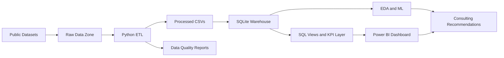

# Student Burnout Analytics

A multi-source student wellbeing analytics project built with Python, SQL, machine learning and Power BI assets.

It combines public student and lifestyle datasets into a conformed analytical model for aggregate analysis.

The project includes an ETL pipeline, SQLite warehouse, SQL queries, model comparisons and dashboard documentation.

> **Disclaimer:** Student Burnout Analytics does not diagnose mental illness, predict individual clinical outcomes, or label individual students. All outputs are intended for aggregate, educational, and resource-planning use only.

## Limitations

- The reported model accuracy reflects the model recovering the risk-scoring formula used to generate its target. It is not independent validation of actual student burnout outcomes.
- Department-level analysis is limited because most source datasets do not include a department field.
- The combined datasets describe different populations and variables. They should not be interpreted as observations from one consistently sampled student population.
- The machine-learning target is an educational high-relative-risk indicator derived from `burnout_risk_index`, not a medical or independently verified burnout outcome.

## What I'd do next

- Add institution-owned anonymized counseling utilization data with governance approval.
- Add timestamped semester data for stronger forecasting.
- Add row-level data contracts and automated Great Expectations checks.
- Publish a completed Power BI `.pbix` after local Desktop authoring.
- Add CI checks for PEP8, SQL validation, and ETL smoke tests.

## Project Overview

Universities often have fragmented information about academic pressure, sleep, attendance, lifestyle habits, and support utilization.

This project explores how public datasets can be organized into an analytical layer to examine population-level wellbeing patterns and support resource planning.

## Project Status

The pipeline, warehouse, SQL layer, and machine-learning workflow are designed to run against five public datasets:

- UCI Student Performance
- Student Mental Health
- Student Depression
- Student Stress Monitoring
- Sleep Health & Lifestyle

The README reports 31,336 unified observations across the multi-source design.

Raw source files are bundled under `data/raw/`. The documented ETL command is:

```bash
python python/etl.py
```

This allows the pipeline to run without requiring a Kaggle account for the bundled datasets.

See `reports/BUSINESS_RECOMMENDATIONS.md` for the interpretation of the combined results and their limitations.

## Setup

### Requirements

- Python
- Pandas
- NumPy
- Scikit-learn
- SQLite
- SQL
- Power BI for local dashboard authoring

### Install dependencies

```bash
pip install -r requirements.txt
```

### Run the ETL pipeline

```bash
python python/etl.py
```

### Run model comparison

Run this after the ETL pipeline:

```bash
python python/model.py
```

## Project Structure

```text
MindPulse/
├── data/
│   ├── raw/
│   ├── processed/
│   └── external/
├── notebooks/
├── sql/
├── powerbi/
├── python/
├── dashboard_screenshots/
├── architecture/
├── reports/
├── documentation/
├── README.md
└── requirements.txt
```

## Data Sources

| Dataset | Source | Rows |
|---|---|---:|
| Student Mental Health Dataset | Kaggle | 101 |
| Student Depression Dataset | Kaggle | 27,901 |
| Student Stress Monitoring Datasets | Kaggle | 1,916 across 2 files |
| Sleep Health and Lifestyle Dataset | Kaggle | 374 |
| UCI Student Performance Dataset | UCI | 1,044 |

See `documentation/DATASETS.md` and `reports/download_manifest.json` for source information.

## Pipeline Architecture



## SQL Analysis

The SQL layer includes:

- `sql/schema.sql`: conformed schema and indexes.
- `sql/cleaning.sql`: cleaning views and quality checks.
- `sql/views.sql`: KPI and dashboard views.
- `sql/analysis.sql`: 55 analytical SQL queries.

The documented analysis covers stress, gender, age, sleep duration, workload, attendance, exercise, financial stress, social support, study hours, counseling utilization, burnout indicators, and department resource planning.

Department-level findings should be interpreted cautiously because most source datasets do not contain department information.

## Machine Learning

The machine-learning workflow compares:

- Logistic Regression
- Random Forest
- Decision Tree
- XGBoost, if installed

The reported evaluation metrics include:

- Accuracy
- Precision
- Recall
- F1
- ROC AUC

The target is an educational high-relative-risk indicator derived from `burnout_risk_index`.

The reported model accuracy reflects recovery of the underlying risk-scoring formula. It does not establish that the model can independently predict real-world burnout.

## Power BI Dashboard

Dashboard build instructions are available in:

`documentation/POWERBI_BUILD_GUIDE.md`

The repository does not currently contain a completed `.pbix` file.

The file `powerbi/MindPulse.pbix.placeholder.md` explains how to build the dashboard locally using Power BI Desktop.

The following images are illustrative portfolio mockups, not live Power BI exports:

- `01_executive_overview.png`
- `02_student_wellbeing.png`
- `03_academic_pressure.png`
- `04_sleep_lifestyle.png`
- `05_burnout_risk_trends.png`
- `06_department_analysis.png`
- `07_resource_planning.png`
- `08_predictive_analytics.png`

The recommended dashboard pages are:

1. Executive Overview
2. Student Wellbeing
3. Academic Pressure
4. Sleep & Lifestyle
5. Burnout Risk Trends
6. Department Analysis
7. Resource Planning
8. Predictive Analytics

## Key Deliverables

| Deliverable | Location |
|---|---|
| SQLite warehouse | `data/processed/mindpulse.sqlite` |
| Unified fact table | `data/processed/fact_wellbeing_observation.csv` |
| Data dictionary | `reports/data_dictionary.json` |
| Data quality report | `reports/data_quality_report.json` |
| Download manifest | `reports/download_manifest.json` |
| Correlation heatmap | `reports/correlation_matrix.png` |
| Risk-segment distribution | `reports/risk_distribution.png` |
| Model comparison metrics | `reports/model_metrics.json` |
| Trained model artifact | `data/processed/burnout_risk_model.joblib` |
| Business recommendations | `reports/BUSINESS_RECOMMENDATIONS.md` |
| Ethics documentation | `documentation/ETHICS.md` |

## Ethics

The project is intended to support student-centered resource planning, not surveillance or punitive intervention.

Its outputs should be interpreted at an aggregate level and should not be used as individual clinical assessments.

See `documentation/ETHICS.md`.

## License

See the repository's license file for usage terms.
