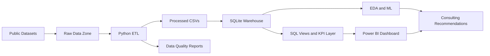

# MindPulse

## Student Burnout & Mental Wellbeing Analytics Platform

MindPulse is a production-style analytics portfolio project for university wellbeing planning. It combines real public student and lifestyle datasets into a conformed analytical model, creates SQL-based KPI views, and provides an educational machine-learning workflow for estimating a non-diagnostic Burnout Risk Index.

> MindPulse does not diagnose mental illness, predict individual clinical outcomes, or label individual students. All outputs are intended for aggregate, educational, and resource-planning use only.

## Project Status

**All five datasets are live.** The pipeline, warehouse, SQL layer, and ML workflow run end-to-end against the full multi-source design: UCI Student Performance, Student Mental Health, Student Depression, Student Stress Monitoring, and Sleep Health & Lifestyle — 31,336 unified observations total. All raw source files are bundled under `data/raw/` so `python python/etl.py` reproduces every number in `reports/` with no Kaggle account needed. See `reports/BUSINESS_RECOMMENDATIONS.md` for an honest read of what these combined numbers do and don't support (in particular: department-level breakdowns are still limited because most sources don't collect a department field, and the reported model accuracy reflects the model recovering its own risk-scoring formula rather than an independently validated outcome — both are explained there).

## Business Problem

Universities often have fragmented signals about academic pressure, sleep, attendance, lifestyle habits, and support utilization. Leadership needs a responsible analytics layer that helps identify population-level wellbeing trends and plan services without misusing sensitive mental-health data.

## Objectives

- Validate real public datasets and document their quality.
- Standardize column names and source structures.
- Combine unrelated datasets through a conformed star-schema style model without fabricating row-level relationships.
- Build SQLite tables, views, indexes, CTEs, window-function queries, and 50+ analytical SQL queries.
- Generate data quality and data dictionary outputs.
- Provide EDA, ML, and Power BI dashboard assets suitable for an interview portfolio.

## Architecture



## Datasets

| Dataset | Source | Status |
|---|---|---|
| Student Mental Health Dataset | Kaggle | Bundled in `data/raw/`; loaded (101 rows) |
| Student Depression Dataset | Kaggle | Bundled in `data/raw/`; loaded (27,901 rows) |
| Student Stress Monitoring Datasets | Kaggle | Bundled in `data/raw/`; loaded (1,916 rows across 2 files) |
| Sleep Health and Lifestyle Dataset | Kaggle | Bundled in `data/raw/`; loaded (374 rows) |
| UCI Student Performance Dataset | UCI | Bundled in `data/raw/`; loaded (1,044 rows) |
| UCI Student Performance Dataset | UCI | Automatically downloaded and processed |

See `documentation/DATASETS.md` and `reports/download_manifest.json`.

## Technology Stack

- Python
- Pandas
- NumPy
- Scikit-learn
- SQLite
- SQL
- Power BI
- Markdown
- Git/GitHub

## Project Structure

```text
MindPulse/
├── data/
│   ├── raw/
│   ├── processed/
│   └── external/
├── notebooks/
├── sql/
├── powerbi/
├── python/
├── dashboard_screenshots/
├── architecture/
├── reports/
├── documentation/
├── README.md
└── requirements.txt
```

## Run the Project

Install dependencies:

```bash
pip install -r requirements.txt
```

Run ETL:

```bash
python python/etl.py
```

Run model comparison after ETL:

```bash
python python/model.py
```

## SQL Layer

Key files:

- `sql/schema.sql`: conformed schema and indexes.
- `sql/cleaning.sql`: cleaning views and quality checks.
- `sql/views.sql`: KPI and dashboard views.
- `sql/analysis.sql`: 55 analytical SQL queries.

Business questions covered include stress by department, gender, age, sleep duration, workload, attendance, exercise, financial stress, social support, study hours, counseling utilization, burnout indicators, and department resource planning.

## Machine Learning

The ML workflow compares:

- Logistic Regression
- Random Forest
- Decision Tree
- XGBoost, if installed

Metrics:

- Accuracy
- Precision
- Recall
- F1
- ROC AUC

The target is an educational high-relative-risk indicator derived from `burnout_risk_index`. It is not a medical label.

## Power BI Dashboard

Dashboard build instructions are in `documentation/POWERBI_BUILD_GUIDE.md`.

The `.pbix` file itself is not included in this repo yet — `powerbi/MindPulse.pbix.placeholder.md` explains how to build it locally from `documentation/POWERBI_BUILD_GUIDE.md`. In the meantime, generated portfolio screenshot **mockups** (illustrative, not live Power BI exports) are available in `dashboard_screenshots/`:

- `01_executive_overview.png`
- `02_student_wellbeing.png`
- `03_academic_pressure.png`
- `04_sleep_lifestyle.png`
- `05_burnout_risk_trends.png`
- `06_department_analysis.png`
- `07_resource_planning.png`
- `08_predictive_analytics.png`

Recommended pages:

1. Executive Overview
2. Student Wellbeing
3. Academic Pressure
4. Sleep & Lifestyle
5. Burnout Risk Trends
6. Department Analysis
7. Resource Planning
8. Predictive Analytics

## Key Deliverables

- SQLite warehouse: `data/processed/mindpulse.sqlite`
- Unified fact table: `data/processed/fact_wellbeing_observation.csv`
- Data dictionary: `reports/data_dictionary.json`
- Data quality report: `reports/data_quality_report.json`
- Download manifest: `reports/download_manifest.json`
- Correlation heatmap: `reports/correlation_matrix.png`
- Risk-segment distribution chart: `reports/risk_distribution.png`
- Model comparison metrics: `reports/model_metrics.json`
- Trained model artifact: `data/processed/burnout_risk_model.joblib`
- Business recommendations: `reports/BUSINESS_RECOMMENDATIONS.md`
- Ethics documentation: `documentation/ETHICS.md`

## Ethics

MindPulse is designed around privacy, fairness, and responsible AI. It should support student-centered resource planning, not surveillance or punitive intervention. See `documentation/ETHICS.md`.

## Future Improvements

- Add institution-owned anonymized counseling utilization data with governance approval.
- Add timestamped semester data for stronger forecasting.
- Add row-level data contracts and automated Great Expectations checks.
- Publish a completed Power BI `.pbix` after local Desktop authoring.
- Add CI checks for PEP8, SQL validation, and ETL smoke tests.
