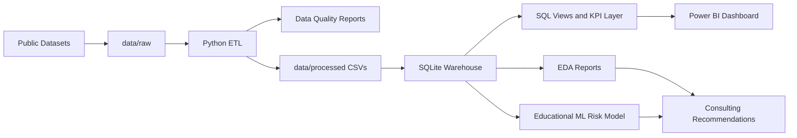

# MindPulse Architecture

## Design Pattern

MindPulse uses a conformed star-schema style analytical layer. Public datasets are preserved as source facts, then mapped into a unified observation table for population-level analytics.

No row-level joins are performed across unrelated datasets.

